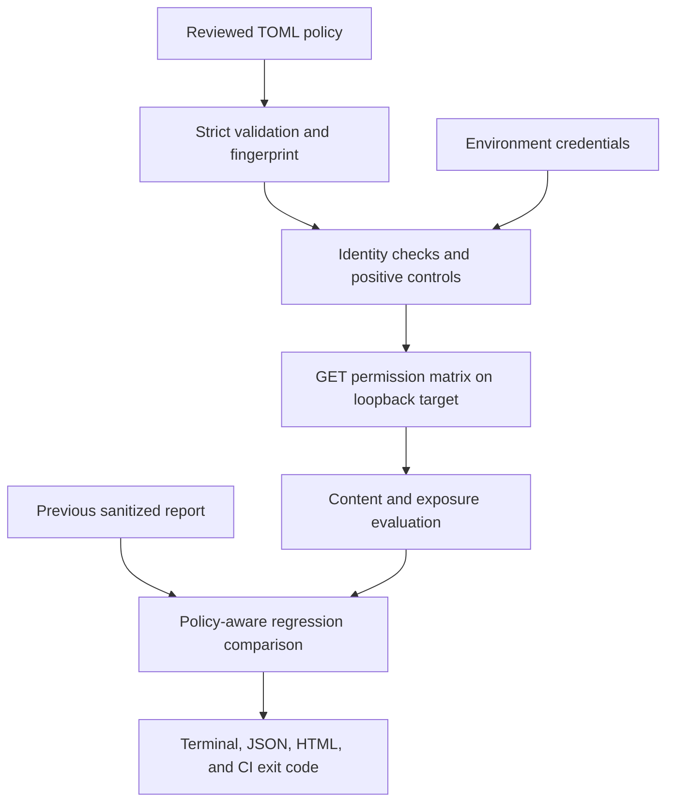

# AccessProof

**A small authorization regression tester for development and CI.** Developers supply a reviewed permission matrix, named test identities, and known sample resources. AccessProof compares expected permissions with observed JSON responses and explains failures without saving response bodies.

Built as a solo cybersecurity portfolio project by Jerson Angelo Bautista. The focus is application security, backend behavior, automated testing, and a useful CI gate.

**Passing configured checks does not establish that an entire application is secure.** AccessProof tests only the declared identities, resources, and assertions. It does not discover endpoints or replace a security review.

## Quick start

Use Python **3.12** (minimum 3.11). There are no third-party runtime or test dependencies. Run commands from this directory after extracting the project. On Windows, use `py -3.12` in place of `python` if needed.

```sh
python --version
python -m unittest discover -v
python -m scripts.walkthrough
```

The walkthrough manages the local demo and public synthetic credentials for you. Leave port **8765** free. It runs three real CLI stages:

| Stage | Expected behavior | CLI exit |
|---|---|---|
| Vulnerable | Four unauthorized-access cases fail | 1 |
| Fixed | All 12 permission checks and six prerequisites pass; four failures resolve | 0 |
| Regression | Reintroduced bugs produce four newly failing checks | 1 |

The walkthrough itself exits `0` when all three stages produce the expected results. It writes HTML, JSON, and terminal reports under `reports/walkthrough/`, plus a machine-readable `evaluation.json`. Open `reports/walkthrough/regression/report.html` in a browser. Sanitized examples are included in [docs/samples](docs/samples/README.md).

For a CI-style run against the corrected demo:

```sh
python -m scripts.ci_demo
```

To demonstrate a blocking regression locally:

```sh
python -m scripts.ci_demo --mode vulnerable
```

The second command must exit `1`. The vulnerable server binds only to `127.0.0.1` and stops when the helper finishes. Do not deploy the intentionally vulnerable demo.

## Run the CLI and demo separately

Set these **public synthetic fixture values** in both terminals. Real credentials belong in environment variables, not configuration, source control, or command-line arguments.

PowerShell:

```powershell
$env:ACCESSPROOF_ALICE_TOKEN = "demo-alice-token-0001"
$env:ACCESSPROOF_BOB_TOKEN = "demo-bob-token-000002"
$env:ACCESSPROOF_ADMIN_TOKEN = "demo-admin-token-0003"
```

macOS/Linux:

```sh
export ACCESSPROOF_ALICE_TOKEN=demo-alice-token-0001
export ACCESSPROOF_BOB_TOKEN=demo-bob-token-000002
export ACCESSPROOF_ADMIN_TOKEN=demo-admin-token-0003
```

Alternatively, copy `.env.example` to `.env` and load it with your shell or editor. The runner reads the process environment; it does **not** automatically execute or load `.env`. `.env` and generated `reports/` are excluded by `.gitignore`.

Terminal 1:

```sh
python -m accessproof demo --mode vulnerable
```

Terminal 2:

```sh
python -m accessproof run configs/demo.toml --out reports/before
```

Stop the demo with Ctrl+C. Start it again using `--mode fixed`, then rerun:

```sh
python -m accessproof run configs/demo.toml --out reports/after --baseline reports/before/report.json
```

The fixed run should report four resolved failures. Then restart `--mode vulnerable` and compare against the corrected report:

```sh
python -m accessproof run configs/demo.toml --out reports/regression --baseline reports/after/report.json
```

It should identify four newly failing permissions. Each output directory contains `report.json` and a standalone `report.html`; no web server is needed for viewing.

## Permission model

| Resource | Owner | Alice | Bob | Admin | Anonymous |
|---|---|---|---|---|---|
| `/records/record-alice` | Alice | Allow | Deny | Allow | Deny |
| `/records/record-bob` | Bob | Deny | Allow | Allow | Deny |
| `/admin/audit` | Admin | Deny | Deny | Allow | Deny |

The synthetic application exposes `/me` to verify identity and role and `/health` for readiness. The three business resources above form the configured permission scope.

The vulnerable variant authenticates users but omits ownership and administrator-role enforcement. The corrected variant checks both before returning data. Both variants live in [accessproof/demo.py](accessproof/demo.py), with explicit comments at the two enforcement points. The demo uses in-memory fixtures and simple bearer-token matching; it is not a production identity provider.

## How a run works



1. Validate the entire policy before any requests. Unknown keys, unsupported methods, ambiguous targets, missing content assertions, duplicate subjects, and invalid references are errors.
2. Verify every authenticated identity against configured subject and role assertions. Missing, invalid, repeated, expired, or incorrect credentials remain visible.
3. Fetch every known resource using its configured legitimate identity. Verify its status, identity fields, and protected-field presence. A failed prerequisite makes that resource's permission matrix inconclusive.
4. Execute the full resource × identity matrix, reusing the positive-control response for that identity. Missing permissions and explicit exclusions appear as skipped checks.
5. Evaluate status **and** configured JSON content. Detect protected fields even in a denial response. An authenticated `401` is inconclusive, never a successful authorization denial.
6. Compare policy fingerprints and equivalent check IDs, sanitize evidence, write reports, and return a meaningful exit code.

| Outcome | Meaning |
|---|---|
| Passed | Prerequisites hold and the configured response contract matches the expectation |
| Failed | Verified unexpected access, a configured protected field exposed, or verified denial of expected access |
| Inconclusive | A prerequisite, authentication, transport, response format, or content contract could not be verified |
| Skipped | Permission was omitted or explicitly excluded with a reason |

Every check is required by default. A required failed, inconclusive, **or skipped** check blocks the gate. An optional resource remains visible but does not block. Identity verification remains required. All required checks must pass even if the same failure was already present in the baseline.

## Configuration and report privacy

[configs/demo.toml](configs/demo.toml) is the complete example. [docs/configuration.md](docs/configuration.md) explains every field and adapting it to another local API.

Reports contain stable check IDs, identity/resource labels, expected permission, observed outcome, HTTP status, body length, assertion-match booleans, and the names of exposed protected fields. They exclude response values, headers, credentials, tokens, raw exception messages, and expected assertion values. Responses are inspected only in memory. Exact configured credential values are redacted from user-supplied report metadata as an additional layer; HTML text is escaped and scripts are disabled. Use synthetic labels and fixtures because report metadata itself can reveal internal structure.

The runner permits only literal loopback IP targets explicitly labeled `development` or `test`. It ignores proxy environment variables, refuses redirects, uses a fresh HTTP connection for every request, accepts no cookie sessions, validates TLS certificates for HTTPS, limits response size, and uses timeouts. A timeout is a socket inactivity limit plus a deadline checked between body reads, not an exact total wall-clock guarantee. GET-only does not make an application endpoint harmless: configure read-only endpoints in a disposable development environment.

## Regression tracking

A canonical SHA-256 fingerprint covers the normalized policy, including its target, permissions, identity assertions, credential variable names, expected content, skip reasons, required flags, limits, policy version, and evaluator version. Environment credential values and TOML formatting are excluded. Reordering resources does not change the fingerprint.

Matching fingerprints and check sets allow comparisons for newly failing, newly inconclusive, and resolved checks. Changed policies produce `policy_changed`; missing baseline rows produce `coverage_mismatch`. Both block the gate, even when the current checks pass. Review the configuration change, then intentionally establish a new baseline by running without `--baseline` into a new directory. The tool never silently updates your baseline. Baseline files are editable reports, not signed or tamper-evident audit records.

## CI integration

The included [.github/workflows/accessproof.yml](.github/workflows/accessproof.yml) runs automated tests, starts the corrected local fixture, invokes the actual CLI, and preserves sanitized reports even when a check fails. It uses read-only repository permissions, pinned action commits, and a job timeout. Dependabot configuration proposes action updates. No deployment, external target, or real secret is needed.

| Exit code | Meaning |
|---|---|
| `0` | All required checks passed and any requested baseline is equivalent |
| `1` | Required check failed, was inconclusive/skipped, or comparison was not equivalent |
| `2` | Invalid configuration/baseline, invalid CLI arguments, or an output/startup error |
| `130` | Interrupted run; incomplete |

A failing workflow marks the check as failed. To block merging on GitHub, configure branch protection or a repository ruleset that requires **AccessProof / authorization**. This package provides the workflow; it does not change GitHub account settings. The workflow has not been executed on hosted GitHub runners in this environment; its Python commands have been verified locally.

## Evaluation and limitations

The repeatable walkthrough detects all four seeded unauthorized-access cases across two defect classes and raises no failures for the corrected 12-case matrix. These are small synthetic fixtures, **not** evidence of general detection accuracy. [docs/evaluation.md](docs/evaluation.md) records cases, one reproduced missed leak, ways false positives can arise, and scope limitations.

Deferred: dashboards, automatic endpoint discovery, write/delete requests, AI, production authentication flows, cookies, OIDC login, query-parameter resource IDs, response arrays at the root, non-JSON APIs, remote targets, database storage, concurrent execution, and signed evidence.

## Learn and explain the implementation

Start with [docs/mentoring.md](docs/mentoring.md) for four small exercises and interview explanations, then [docs/walkthrough.md](docs/walkthrough.md) for a five-minute demonstration. [docs/architecture.md](docs/architecture.md) maps the modules and trust boundaries. You should be able to explain and modify each module before presenting the project as your work; the included implementation is a learning starting point.

## Technical references

- [OWASP API1:2023 — Broken Object Level Authorization](https://api-security.owasp.org/editions/2023/en/0xa1-broken-object-level-authorization/)
- [OWASP API5:2023 — Broken Function Level Authorization](https://github.com/OWASP/API-Security/blob/master/editions/2023/en/0xa5-broken-function-level-authorization.md)
- [Python `http.client`](https://docs.python.org/3/library/http.client.html), [`tomllib`](https://docs.python.org/3/library/tomllib.html), and [`unittest`](https://docs.python.org/3/library/unittest.html)
- [GitHub workflow syntax](https://docs.github.com/en/actions/reference/workflows-and-actions/workflow-syntax) and [workflow artifacts](https://docs.github.com/en/actions/concepts/workflows-and-actions/workflow-artifacts)
