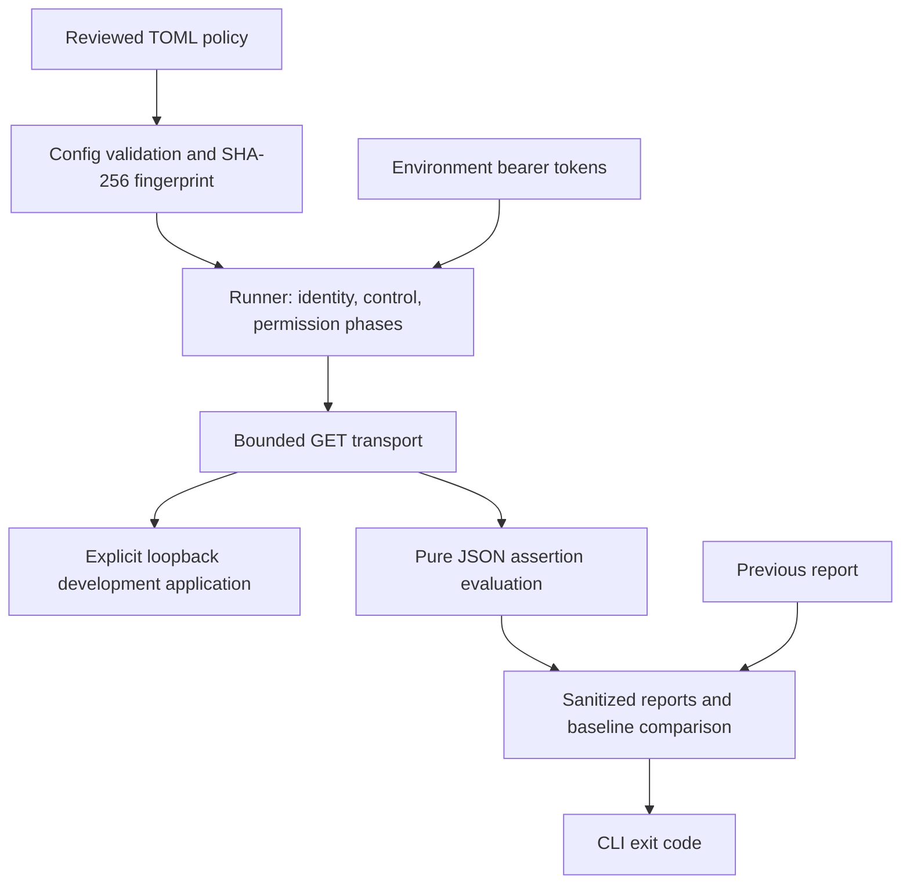

# Architecture and decisions

AccessProof is a synchronous command-line application. It has no database or web dashboard. A run is a small, bounded sequence of GET requests; reports are the persisted result.

| Module | Responsibility | Decision to explain |
|---|---|---|
| `config.py` | Parse TOML, reject malformed policy, normalize types, compute fingerprint | Fail before networking if policy meaning is unclear |
| `transport.py` | GET requests to validated loopback IPs; bound and parse responses | Keep credentials on the explicit target and refuse unsupported responses |
| `evaluation.py` | Resolve JSON pointers and evaluate status/content/exposure | Pure functions make edge cases easy to test independently |
| `runner.py` | Resolve credentials, verify subjects, establish controls, execute matrix | A denial needs working prerequisites to be meaningful |
| `reporting.py` | Compare runs, sanitize, escape HTML, atomically write individual files | Evidence should be useful without retaining private bodies |
| `__main__.py` | CLI parsing, sequencing, exit codes | CI uses the same behavior as a developer's terminal |
| `demo.py` | Local synthetic server and two explicit authorization modes | Provide known ground truth without scanning another service |
| `scripts/` | Reproduce demo lifecycle, CLI invocation, evaluation, and CI | Keep expected demonstration failures separate from the gate's exit code |

## Why a dependency-free first version?

Python's standard library already supplies TOML parsing, HTTP, CLI parsing, HTML escaping, and unit tests. The constrained build environment could not install packages, so the initial implementation uses those facilities directly. This makes the delivered version reproducible offline and keeps its dependency inventory small. The cost is handwritten schema validation and a simple HTTP demo rather than a framework. These are tradeoffs, not a claim that frameworks are less secure.

The validation helpers reject unknown fields, invalid types, unsupported targets, ambiguous subjects, and incomplete assertions. Changes to this validation should come with meaningful negative tests. Consider Pydantic if the policy grows substantially; it should simplify validation without changing the permission semantics.

The HTTP demo is intentionally limited. Python's development HTTP server is sufficient for local synthetic fixtures, not an appropriate production deployment architecture. A future real adapter could use FastAPI without coupling the runner to that framework.

## Trust boundaries

The policy and environment are developer-controlled inputs. Policy files contain expected behavior and fixture identifiers; environment variables contain credentials. The target application supplies untrusted response status, headers, and JSON. The runner uses those bodies in memory and emits only allowlisted evidence. It neither saves response bodies nor prints raw exception messages.

Every request uses a fresh connection and explicit authorization header, preventing cookie persistence or automatic authentication sharing. Hostnames are rejected, so target resolution cannot silently change through DNS. Redirects are returned as inconclusive without requesting their Location. HTTPS uses the standard verified TLS context. HTTP remains available for the disposable loopback demo.

Reports are HTML-escaped and contain no executable JavaScript or external assets. A Content Security Policy disables scripts, remote resources, forms, and base URL changes. Each output file is replaced atomically; the pair is not transactional, so an output failure can leave an old HTML file next to a newer JSON file. Exit code 2 makes that failure visible.

The public Python API is an internal implementation interface; the supported entry point is the validated CLI. Tests can inject a fixture transport to isolate fault handling. The live transport revalidates targets and endpoint paths as defense in depth.

## Comparability

Stable IDs are `identity:<identity>`, `control:<resource>`, and `permission:<resource>:<identity>`. IDs alone do not make checks equivalent. The fingerprint includes the whole normalized configuration and evaluator version; changes to target, policy, assertions, optionality, or exclusions invalidate cross-run comparison. This is conservative: a harmless timeout edit also requires a reviewed baseline refresh.

Credentials are excluded from fingerprints because they rotate. The same declared subject must still pass identity verification. The tool cannot guarantee fixtures remain unchanged between requests, cannot detect all mid-run session changes, and does not use a database snapshot. Run against stable test fixtures.

## Extension boundaries

Before adding remote development targets, define an exact host/IP allowlist, resolution pinning, proxy rules, TLS behavior, and credential-forwarding rules. Before adding writes, define disposable fixtures, cleanup, idempotency, and state isolation. These are separate design tasks and remain outside v1.
