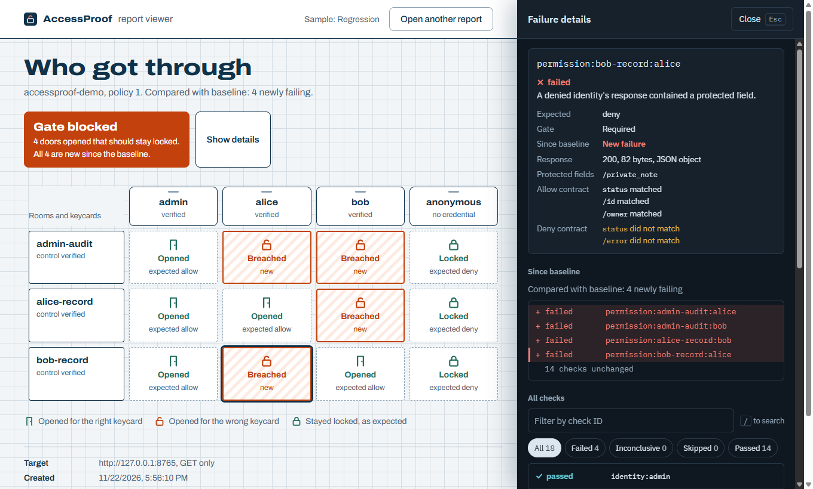

# AccessProof report viewer

**Live:** https://accessproof-iota.vercel.app

A static, client-side viewer for AccessProof's `report.json`. It draws the permission matrix as an access plan: each resource is a room, each identity a keycard, and each permission check a door that is locked, opened, or breached by the wrong keycard. **Show details**, or a click on any door, opens a console-style panel with the evidence, the changes since the baseline, and a filterable list of every check.



## Run it

Requires Node.js 24 to 26. CI and Vercel both build with Node 24, the version in `.nvmrc`.

```sh
cd web
npm ci
npm run dev        # development server
npm test           # unit and interaction tests
npm run build      # type check, then production build in dist/
npm run preview    # serve the production build at http://localhost:4173
```

Open a `report.json` by dropping it on the page or choosing it, or try one of the three bundled samples from `docs/samples/`. A sample and a selected check can be linked directly, for example `#sample=regression&check=permission:bob-record:alice`.

## How it treats report files

Reports describe the internal structure of an application, and they come from editable files, so the viewer handles them defensively:

- **Nothing leaves the browser.** Files are read with the File API. The built page's Content Security Policy sets `connect-src 'none'` and `form-action 'none'`, so the page cannot send data anywhere.
- **Strict Content Security Policy.** `default-src 'none'` with `script-src`, `style-src`, and `font-src` limited to `'self'`: no inline scripts, no `eval`, no third-party hosts. Fonts are self-hosted from Fontsource packages. The policy is defined once in `src/security.ts` and added to production builds by `vite.config.ts`, because the dev server needs inline scripts. On Vercel, `vercel.json` also sends it as an HTTP header with `frame-ancestors 'none'`, which only a header can enforce, alongside `nosniff`, `no-referrer`, and a restrictive `Permissions-Policy`. A test keeps the two copies identical.
- **Schema validation before display.** Every file, including the bundled samples, is checked against [`schema/report.schema.json`](../schema/report.schema.json) and refused with a specific reason if it doesn't conform. The schema is strict, so unexpected fields such as response bodies are rejected.
- **No runtime code generation.** Ajv normally compiles validators with `new Function`, which the policy forbids. `scripts/build-validator.mjs` compiles the schema into a standalone module at build time and replaces Ajv's CommonJS helpers with the ES modules in `src/validator-runtime.ts`. The script fails if the output contains `require`, `eval`, or `new Function`.
- **Text stays text.** All report values are rendered through React's escaping; nothing uses `dangerouslySetInnerHTML`. A test feeds a report containing an `` payload and checks it renders as plain text.
- **8 MB limit**, matching the CLI's limit for baseline files.

## Design

- **Overview: access plan.** Drafting-paper grid, deep ink, and Archivo with its width axis for headings. A breached door uses a burnt-orange border with a hatched fill, so it never depends on color alone; every door also has a text label and a descriptive accessible name.
- **Details: console panel.** Dark, IBM Plex Sans and Plex Mono, with the regression shown as a diff. Breaches use coral, the same hue family as the overview's orange.
- **The gate is displayed, not computed.** The verdict comes from the report's recorded `gate` field. Reports written before that field existed show "Gate verdict not recorded" rather than a guess.
- **Accessibility.** The plan is a real `<table>` with row and column headers. The panel is `inert` while closed. Opening it moves focus to its heading, and Esc closes it and returns focus to the door that opened it. Focus is always visible, targets are at least 40 px, motion respects `prefers-reduced-motion`, and on wide screens the plan shifts left so the selected door stays visible.

## Code map

| File | Role |
|---|---|
| `src/report.ts` | Report types, file reading, schema validation, readable error messages |
| `src/model.ts` | Builds the access plan, door states, verdict text, and comparison headline |
| `src/reasons.ts` | Plain-language reason codes, kept in sync with `docs/report-format.md` by a test |
| `src/components/` | Load screen, access plan, details panel, icons |
| `scripts/build-validator.mjs` | Build-time schema compilation |
| `src/test/` | Contract, model, and interaction tests (Vitest and Testing Library) |
